# Penpot UI/UX 調査レポート

対象: `penpot.app`（マーケティング）、`design.penpot.app`（プロダクト/認証）、`help.penpot.app`（ドキュメント）、`community.penpot.app`
手法: REA による受動的 Web 観測（CDP）＋ 画面キャプチャ ＋ 公開ソースからのデザイントークン抽出
実施日: 2026-11-06

> **証拠の扱い**
> - 各所見には **観測 / 推測 / 不明** を付けた。
> - スクリーンショットは `screenshots/` に保存。本文に埋め込んでいる。
> - REA の Evidence ID は `evidence/SOURCES.md` に一覧化。
> - 数値は `evidence/audit-*.json` に生データを保存。

---

## 0. 30秒サマリ

Penpot は「オープンソースのデザインプラットフォーム」で、UI は **プロ向けツールの密度**と**ブランドの軽さ**を意図的に分けている。

- **マーケティングサイト**は Work Sans の 72px・weight 400 という「細くて大きい」見出し、ティール（#14CECA）の単一アクセント、余白の広い編集的なレイアウト。Figma の競合として「オープンソース」「セルフホスト」「ベンダーロックインなし」を視覚的に主張する。
- **プロダクト**は既定がダークテーマ（#18181a）、アクセントはティール（#00d1b8）。339 個のセマンティックトークンで構成され、コンポーネント単位のトークン層を持つ成熟した設計。
- **ドキュメント**はマーケとは別の視覚言語（極太見出し）で、情報密度優先。

一方で、**価格表のラベルと値の矛盾**、**比較表の非セマンティック実装**、**モバイルメニューのはみ出し**など、修正すべき具体的な欠陥も確認できた（§8）。

---

## 1. プロダクトの構造（3つの面）

Penpot の UI は「3つの面」で構成される。公式ドキュメントもこの3分割で説明している（観測）。

```
┌──────────────────────────────────────────────────────────────┐
│  Dashboard（入口）                                            │
│  チーム / プロジェクト / ドラフト / ライブラリ / フォント      │
│  ・Recent / Deleted タブ                                      │
│  ・ファイルカード（サムネイル）                                │
└───────────────────────────┬──────────────────────────────────┘
                            │ ファイルを開く
                            ▼
┌──────────────────────────────────────────────────────────────┐
│  Workspace（制作）                                             │
│ ┌─────────┬───────────────────────────────┬────────────────┐ │
│ │ Layers  │                               │ Design         │ │
│ │ Assets  │        キャンバス              │ Prototype      │ │
│ │ Tokens  │        （無限）                │ Inspect        │ │
│ │ Pages   │                               │                │ │
│ └─────────┴───────────────────────────────┴────────────────┘ │
│  上部: ツールバー（中央のピル）／ルーラー／ズーム／履歴／共有   │
│  下部: カラーパレット／タイポグラフィパレット                  │
└───────────────────────────┬──────────────────────────────────┘
                            │ プレビュー
                            ▼
┌──────────────────────────────────────────────────────────────┐
│  View mode（共有・検証）                                       │
│  プレゼン / コメント / Inspect（コード取得）                  │
└──────────────────────────────────────────────────────────────┘
```

### 1.1 Workspace の情報設計（ドキュメント準拠・20領域）

公式の「Interface tour」は 20 の領域を列挙している（観測）。要約すると4つの帯に分かれる。

| 帯 | 要素 | 役割 |
|---|---|---|
| 左 | Pages / Layers / Assets / Tokens | 構造と資産。タブで切替 |
| 中央 | Viewport / Rulers / ツールバー | 制作。ツールバーは中央の浮遊ピル |
| 右 | Design / Prototype / Inspect | 属性編集と出力。モード切替 |
| 上下端 | メニュー / ズーム / 履歴 / コメント / 共有 / ユーザー / ファイル状態 | グローバル操作 |

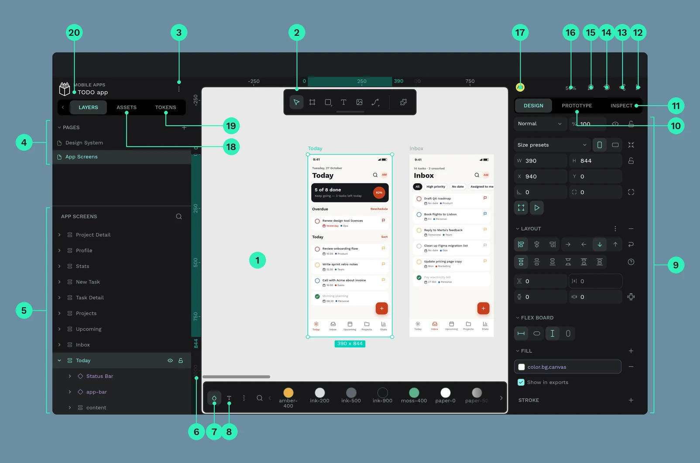

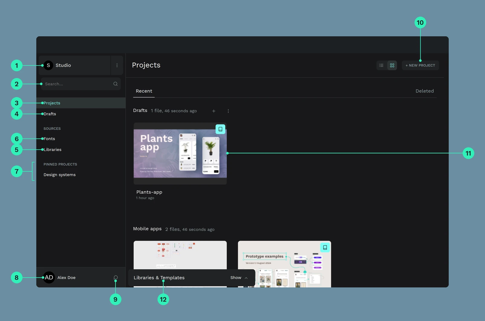

**設計上の観察（観測）**: 右サイドバーを「Design / Prototype / Inspect」のモード切替にしている点が、Figma との明確な差別化になっている。制作・試作・受け渡しを同一画面で切り替えるため、画面遷移が少ない。一方で、モードの存在に気づかないと Inspect 機能に到達できない（推測）。

**観察（観測）**: ツールバーが画面上部に固定されず、**キャンバス上に浮く中央ピル**になっている。これは「キャンバスが主役」というメッセージで、周辺ツール（FigJam 的な発想）ではなく制作ツールであることを示す。

---

## 2. デザインシステム（公開ソースから抽出）

Penpot はオープンソースなので、UI のトークンがコードとして公開されている。ここは推測ではなく**実装の事実**として読める（観測）。

出典: `frontend/resources/styles/common/refactor/`

### 2.1 色

プリミティブ（`color-defs.scss`）:

| 用途 | 値 |
|---|---|
| ダーク背景 | `#18181a` |
| ダーク時の補助前景 | `#8f9da3` |
| ライトのアクセント | `#8c33eb`（紫） |
| ダークのアクセント | `#00d1b8`（ティール） |
| 成功 | `#2d9f8f` |
| 警告 | `#f5a91b` |
| エラー | `#ff3277` |
| 情報 | `#0e9be9` |
| パス選択 | `#f49ef7`（ピンク） |

マーケティングサイト側のアクセントは `rgb(20, 206, 202)` = **#14CECA**（観測・実測）。プロダクトの #00d1b8 と近いが同一ではない。**ブランドとプロダクトで微妙に色が違う**（観測。意図かは不明）。

### 2.2 タイポグラフィ

```
$fs-base: 16
10 / 11 / 12 / 14 / 16 / 18 / 20 / 24 / 36 (rem)
weight: 400 / 500 / 700 のみ
line-height: 1.5
```

マーケティングサイトは **Work Sans**、見出しは 72 / 65 / 48px で weight 400（観測・実測）。プロダクトは同じ Work Sans を基調にしつつ、UI では 12–14px 帯を多用する（推測。CSS のスケールから）。

### 2.3 余白・角丸・レイヤー

- 余白: **4px 基底**（0.25rem の倍数）。1px / 2px / 3px / 6px の例外あり
- 角丸: 0 / 2 / 4 / 5 / 6 / 8 / 10 / 12 / 50%（9 種）
- z-index: 1–5, 10, 20, 300, 400（**飛び値がある**。300/400 は後付けの可能性）

### 2.4 トークンの構造

`design-tokens.scss` には **339 個**のカスタムプロパティがある（観測・機械カウント）。構造は2層。

```
プリミティブ        --color-background-primary
                    --color-accent-primary
                    --status-color-error-500
                        │
                        ▼
コンポーネント      --button-primary-background-color-rest
                    --button-primary-background-color-hover
                    --button-primary-foreground-color-focus
                    --layer-row-background-color-selected
                    --tab-foreground-color-selected
```

これは教科書的な **2 層トークン設計**で、状態（rest / hover / active / focus / disabled）を明示的に持つ。デザインシステムの成熟度を示す強い証拠（観測）。

### 2.5 フォーカス

```scss
&:focus-visible {
  outline: none;
  background-color: var(--button-...-background-color-focus);
  border: 1px solid var(--button-...-border-color-focus);
  color: var(--button-...-foreground-color-focus);
}
```

`focus-visible` を使っている点は良い。ただし **outline を消して背景色と枠線で代替**しているため、背景と同系色の面では視認性が落ちる可能性がある（推測。実画面での検証は未実施）。

### 2.6 テーマ

`default`（ダーク）と `light` の2テーマ。**既定がダーク**（観測）。デザインツールとしては妥当だが、初見のユーザーには重く見える可能性がある（推測）。

---

## 3. マーケティングサイトの UX

### 3.1 ファーストビュー

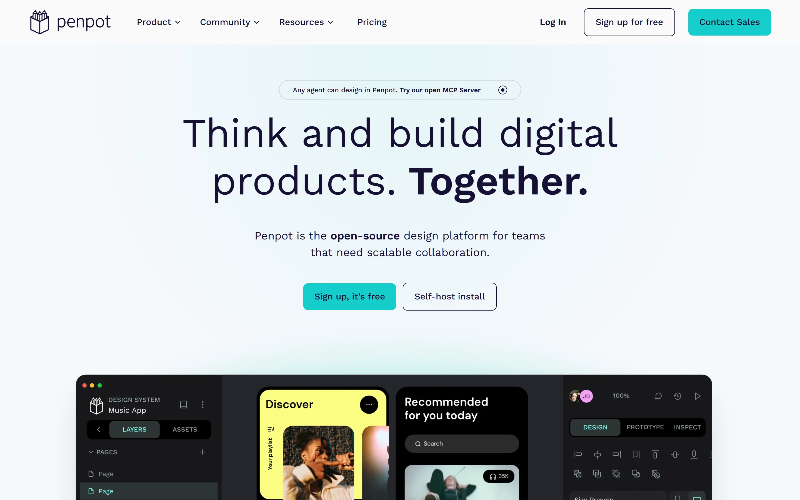

- 見出し: 「Think and build digital products. Together.」72px / weight 400
- サブ: 「Penpot is the **open-source** design platform for teams that need scalable collaboration.」
- CTA: 「Sign up, it's free」（ティール塗り）／「Self-host install」（白抜き）
- 上部に小さなピル: 「Any agent can design in Penpot. **Try our open MCP Server**」

**観察（観測）**: 主 CTA が「無料登録」で、副 CTA が「セルフホスト」。この2つを**同じ強さで並べている**のは珍しい。多くの SaaS は「営業に相談」を副 CTA にする。Penpot は「無料で使う」「自分で運用する」の二択を最初に出し、オープンソースの立場を最初の一画面で宣言している。

**観察（観測）**: ヒーロー直下のアプリモックアップは画像ではなく、**Vimeo の背景自動再生 iframe**（`player.vimeo.com/video/...?background=1`）。ヘッドレス環境では黒/空白になった（`screenshots/01c-ui-design.webp`）。静止画のフォールバックがないため、動画が読めない環境では**セクションが空になる**。これは可用性とアクセシビリティの両面で改善余地がある（観測）。

### 3.2 情報アーキテクチャ

グローバルナビは4項目＋右側3つ。

```
Product ▾    Community ▾    Resources ▾    Pricing        Log In   [Sign up for free]  [Contact Sales]
```

- `Product` 配下: Self-host / AI Workflows / Features / Release notes / Integrations & API / Business Cases
- `Community` 配下: Community Space / Ambassador Program / Wall of love / Penpot Fest / Blog
- `Resources` 配下: Learning Center / Penpot UI Course / Plugins / Libraries & Templates / Tutorials / Dev Diaries / Help Center

**観察（観測）**: 「Pricing」だけがドロップダウンでなく直リンク。意思決定に近い項目を1クリックで出している。

### 3.3 機能ページ

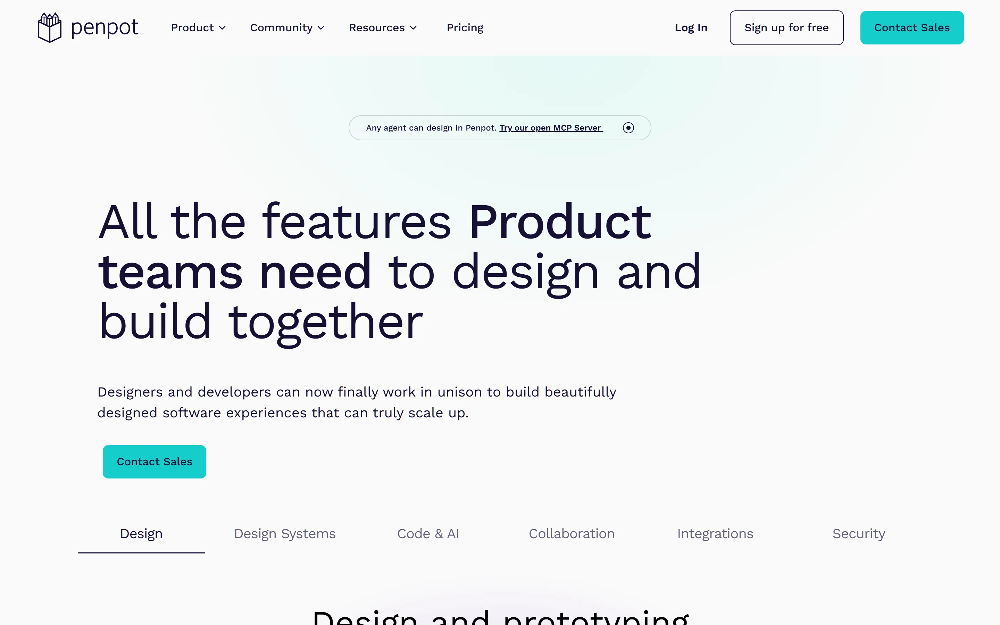

- 左寄せの巨大見出し（ホームは中央寄せ）。**ページ間で整列が異なる**（観測）
- タブ: Design / Design Systems / Code & AI / Collaboration / Integrations / Security
- タブは `<button type="button">` だが、`role="tab"` / `aria-selected` / `aria-controls` がない（観測・DOM 実測）。**選択状態が下線の視覚のみ**で、支援技術に伝わらない

### 3.4 価格ページ


構成は明快: ヒーロー → Cloud/Self-host トグル → 4 プラン → 「全プラン共通の機能」→ 比較表 → FAQ → 社会的証明 → ニュースレター → フッター。

**良い点（観測）**
- 価格を隠さない（$0 / $7 / $25 / $50k）
- FAQ に「How is Penpot funded?」「What if Penpot discontinues?」という**不安に直答**する項目がある
- 「Non-profit, education and open-source discounts」を明記

**問題点（観測）**

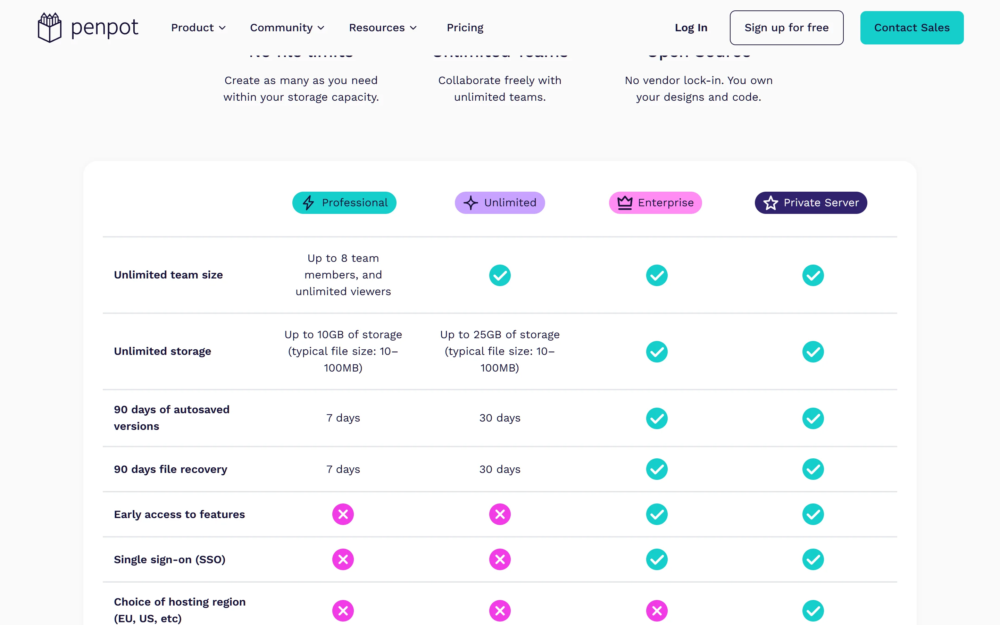

1. **ラベルと値が矛盾している**
   - 行「Unlimited team size」→ Professional の値は「Up to 8 team members」
   - 行「Unlimited storage」→ Professional は「Up to 10GB」、Unlimited は「Up to 25GB」
   - 行「90 days of autosaved versions」→ 実際は 7 days / 30 days
   行名が「上限なし」と言い、同じ行の値が上限を示す。読み手は一瞬で意味を失う。
2. **比較表が `<table>` ではない**（実測: `table: 0`, `role=table: 0`, `role=row: 0`）。div グリッドで組まれているため、スクリーンリーダーには行と列の関係が伝わらない（WCAG 1.3.1）。
3. **課金単位がカードごとに違う**（user / editor / member / year）。横並び比較の前提が崩れている。
4. **プラン名と価格の慣習が逆**。「Professional」が $0 で、「Unlimited」が $7。一般的には Professional が有料の中位帯。

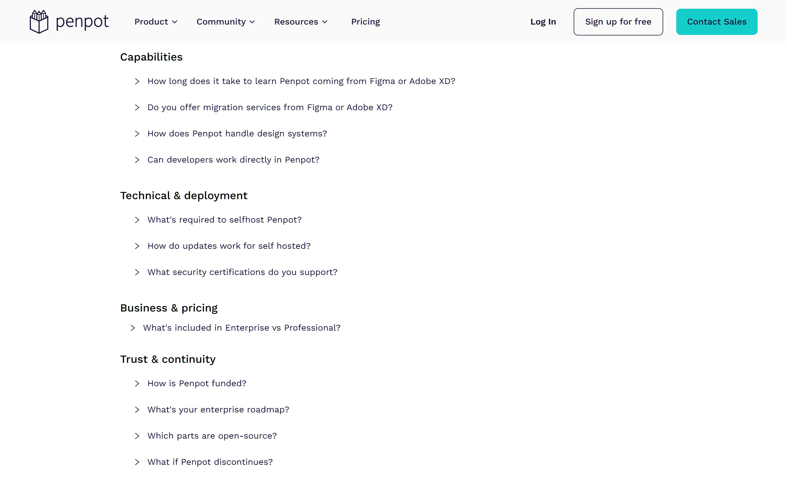

### 3.5 AI の位置づけ

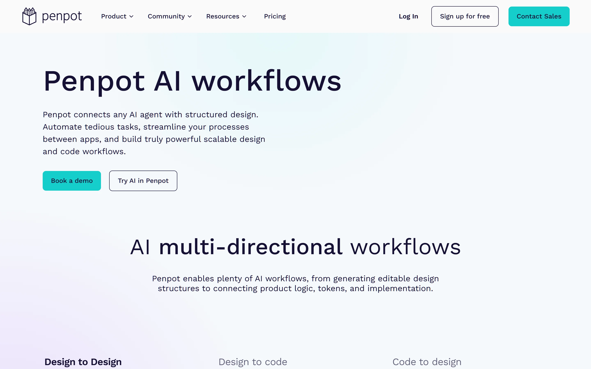

「Penpot AI workflows」は、**デザイン→コード、コード→デザイン、デザイン→デザイン**の3方向を掲げる。CTA は「Book a demo」が主で「Try AI in Penpot」が副。マーケのトップにも「Any agent can design in Penpot」のピルがあり、**AI を主役の一つに格上げ**している（観測）。

### 3.6 404

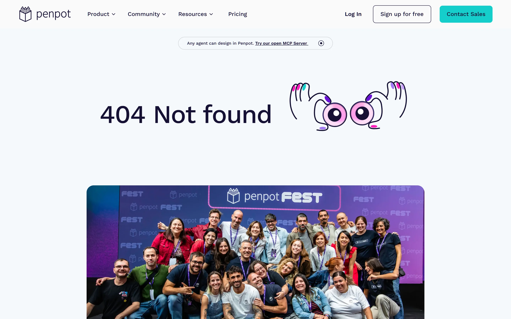

「404 Not found」＋ブランドイラスト＋チーム写真。**本文内に復帰導線がない**（観測: main 内にリンクなし）。グローバルナビはあるが、「探し物をしていた人が次にどこへ行くか」は設計されていない。

### 3.7 実装の観測

- マーケティングサイトは **Plasmic**（`site-assets.plasmic.app` / `img.plasmic.app`）で構築されている（観測）。デザインツール企業がマーケサイトをノーコードビルダーで作っているのは興味深い事実。
- 画像は `data:image/svg+xml` のプレースホルダから遅延差し替え（LQIP 的な手法）。
- 計測は Google Tag Manager のみ（観測。プロダクト側のような PostHog 等は未検出）。

---

## 4. 認証フローの UX

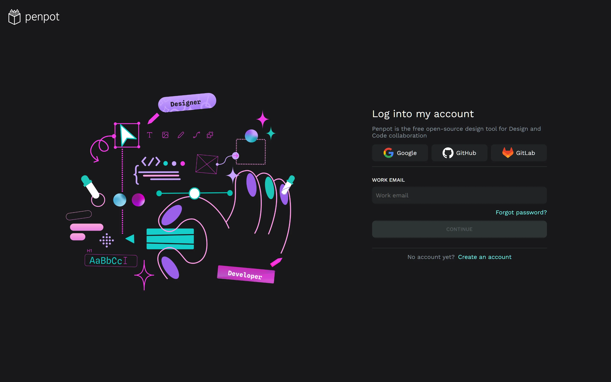

- 画面は左右分割。左にブランドイラスト（Designer / Developer の落書き）、右にフォーム
- SSO は Google / GitHub / GitLab の3つ
- メール1項目 →「CONTINUE」。パスワード入力は次のステップ（パスワードレス or 段階入力）
- 「Forgot password?」が**メール未入力の時点で表示**されている

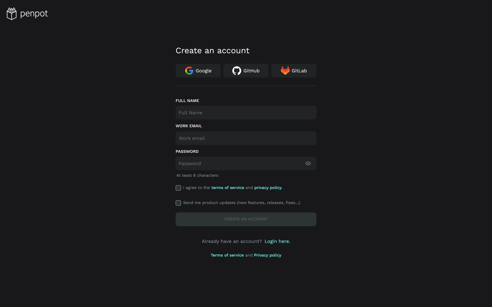

- Full name / Work email / Password（8文字以上、ヘルパーテキストあり）
- 規約同意は**必須チェック**、製品アップデートは**任意チェック（既定オフ）**
- 主ボタンは入力完了まで無効（disabled）

**観察（観測）**
- 登録フォームの項目は最小限で、B2B SaaS として妥当
- マーケティング同意が既定オフなのは良い実践
- ログイン画面の装飾イラストに `alt` がない（実測: 画像1枚、`missingAlt: 1`）。装飾なら `alt=""` を明示すべき
- ログイン画面に **空の `<h1>` が1つ**あり、見出しが2つになる（実測: h1 = 2）。ブランド名の見出しと「Log into my account」が並ぶ

---

## 5. レスポンシブ

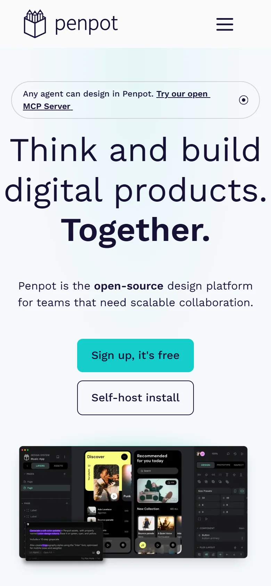

- 390px 幅でもレイアウトは破綻しない（横スクロールなし・実測）
- ただし H1 が 72px のままで、**画面の大部分を文字が占める**（観測）。ファーストビューで伝わる情報は「見出し」と「CTA」だけになる

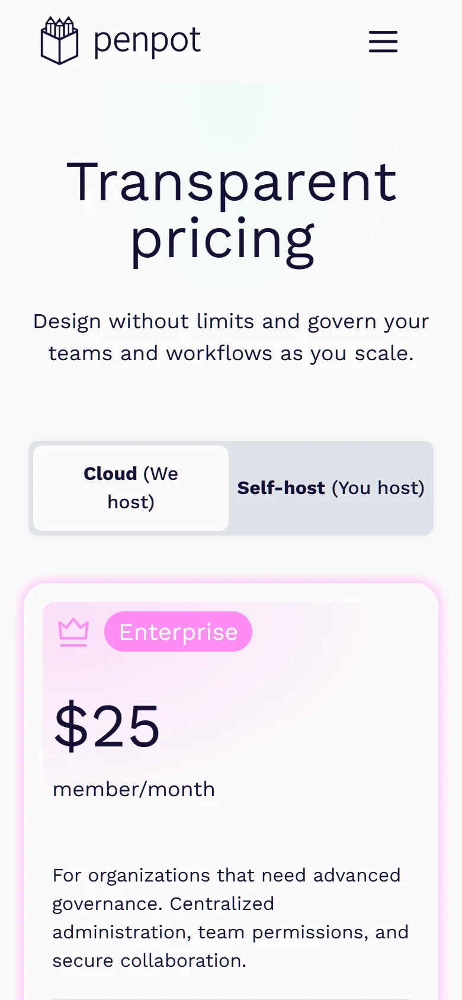

**問題（観測）**
1. **Cloud / Self-host トグルのラベルが折り返す**（「Cloud (We」/「host)」）。トグルは2択の比較 UI なので、折り返しは可読性を落とす
2. **カードの順序がデスクトップと違う**。デスクトップは Professional → Unlimited → Enterprise → Private Server、モバイルは **Enterprise → Professional → Unlimited → Private Server**（DOM 実測）。モバイルの第一印象が $25 になる

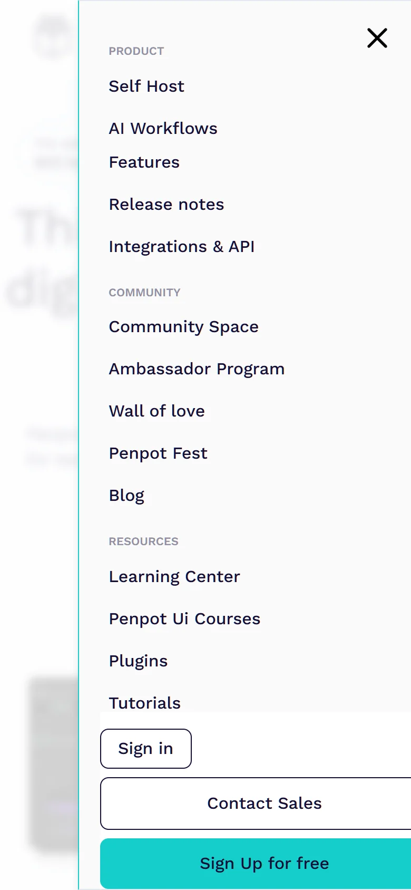

**問題（観測・実測）**
- メニュー下部の CTA が**右にはみ出している**。ボタンは `x=95, width=312` で右端 `407`、ビューポートは `390`。17px が画面外に出て切れる
- 左は 95px インデントされているのに右は 0。**左右の余白が非対称**

---

## 6. アクセシビリティ監査（実測）

`scripts/audit.js` を各ページで実行した結果（生データ: `evidence/audit-*.json`）。

| ページ | h1 | 見出し飛び | alt 欠落 | コントラスト不合格 | 24px 未満の操作要素 | 44px 未満 |
|---|---|---|---|---|---|---|
| ホーム | 1 | 1 (h2→h4) | 0 / 25 | 0 / 65 | 10 / 116 | 54 |
| Features | 1 | 1 | 0 | 0 / 97 | 13 / 170 | 93 |
| Pricing | 1 | 1 | 0 | 0 / 78 | 12 / 139 | 56 |
| Help center | 1 | 0 | 0 | **1 / 84** | **65 / 79** | 70 |
| アプリ ログイン | **2** | 0 | **1 / 1** | 0 / 6 | 2 / 8 | 7 |

**読み方**
- マーケティング3ページは**コントラスト合格**（0 件）。画像 alt も全付与。基礎品質は高い
- ヘルプセンターは**ナビゲーションとフッターのリンク 65/79 が 24px 未満**（内訳を実測: 上部ナビ、フッターの製品/リソース列）。WCAG 2.5.8（AA）の 24×24px を下回る。文章中のインラインリンクは例外だが、ナビゲーションは該当しない
- ヘルプセンターのフッター著作権表示は **4.01:1**（16px・通常 weight は 4.5:1 必要）
- ログイン画面の h1 重複と alt 欠落は、マーケ側と比べて**品質基準が揃っていない**ことを示す

---

## 7. 強み（そのまま残すべき点）

1. **2層トークン設計**（339 個）。状態を網羅し、テーマ切替に耐える構造
2. **マーケのコントラストと alt の徹底**。装飾画像は空 alt、内容画像は説明的 alt
3. **ランドマークと h1 の基本遵守**（マーケ3ページ）
4. **価格の透明性**。$0 から $50k まで、FAQ で資金調達や事業継続リスクまで開示する
5. **オープンソースの立場を UI で表明**。ヒーローで「Self-host install」を同格に置く
6. **ダークテーマ既定**。長時間使うプロツールとして妥当
7. **モード切替（Design / Prototype / Inspect）**。画面遷移を減らす設計判断

---

## 8. 発見した問題（重大度順）

| # | 問題 | 重大度 | 根拠 |
|---|---|---|---|
| 1 | 価格表の行ラベルと値が矛盾（Unlimited なのに上限あり） | 高 | `03b-pricing-table.png` |
| 2 | 比較表が非セマンティック（table/role なし） | 高 | 実測 `table:0, role=table:0` |
| 3 | モバイルメニューの CTA が右に 17px はみ出す | 中 | 実測 `right=407 / viewport=390` |
| 4 | ヘルプセンターのナビ／フッターが 24px 未満（65/79） | 中 | `audit-help.json` |
| 5 | 機能タブに選択状態のセマンティクスがない | 中 | `role=tab` なし・`aria-selected` なし |
| 6 | ログイン画面に空 h1（h1 が2つ） | 中 | `audit-app-login.json` |
| 7 | ログイン画面の装飾画像に alt がない | 低 | 実測 `missingAlt:1` |
| 8 | モバイルで価格カードの順序が変わる | 低（要意図確認） | DOM 実測 |
| 9 | モバイルのトグルでラベルが折り返す | 低 | `06b-mobile-pricing.png` |
| 10 | 404 に復帰導線がない | 低 | `12-404.png` |
| 11 | 主要デモが動画のみで静止画フォールバックなし | 低 | `01c-ui-design.png` |
| 12 | マーケとプロダクトでアクセント色が微妙に違う（#14CECA / #00d1b8） | 低 | 実測 |
| 13 | コピーの不統一（「Penpot Ui Courses」、docs の「Leran more」） | 低 | 実画面 |
| 14 | プラン名と価格の慣習が逆（Professional = $0） | 低 | `03a-pricing-hero.png` |

---

## 9. 改善提案（優先度順）

### P0: 価格表の意味を直す
行ラベルを「Team size」「Storage」「Version history」に変え、値を各列に置く。可能なら `<table>` か `role="table"` + `rowheader`/`columnheader` で組み直す。課金単位も「1 ユーザーあたり」に統一する。

### P1: モバイルの CTA はみ出しを修正
メニュー下部のコンテナに `padding-right` を与えるか、ボタンを `width: 100%` にして左右のインセットを揃える。あわせて 390px での回帰テストを CI に入れる。

### P1: ヘルプセンターの操作要素を 24px 以上に
ナビゲーションとフッターのリンクに `padding-block` を追加するだけで AA を満たせる。フッターの著作権表示は色を 1 段明るくする（4.01 → 4.5 以上）。

### P2: タブとアコーディオンの状態を伝える
機能タブに `role="tablist"` / `role="tab"` / `aria-selected` を付ける。FAQ は既に `aria-expanded` があるので、同じ作法をタブにも適用する。

### P2: 認証画面の見出し構造を修正
空の h1 を削除し、ブランドは `div` か `aria-hidden` にする。装飾イラストは `alt=""`。

### P3: 404 に復帰導線を追加
「Home」「Help center」「Search」の3つを本文内に置く。ブランドイラストは残してよい。

### P3: 動画デモに静止画フォールバックを追加
`prefers-reduced-motion` と回線速度に応じて poster 画像を出す。現状は動画が読めないとセクションが空白になる。

---

## 10. 限界（この調査で確認できていないこと）

- **エディタ内部の実操作は未検証**。`design.penpot.app` は認証が必要で、アカウント作成は依頼者の同意なく行っていない。Workspace の評価は公式ドキュメントの注釈画像とトークン定義に基づく（§1、§2）。
- **スクリーンリーダーでの実読上げは未実施**。DOM とアクセシビリティツリーの構造からの推定。
- **キーボード操作の通し検証は未実施**（フォーカス順、トラップ、ショートカット競合）。
- **パフォーマンス測定は未実施**（LCP/CLS/INP）。リソース数とスクリプト数の観測のみ。
- **A/B テストや意図の確認はできない**。モバイルのカード順などは「意図的な最適化」の可能性がある。

> エディタ内部まで検証する場合は、検証用アカウント（無料枠）を用意いただければ、Workspace の実操作・キーボード操作・スクリーンリーダー読上げまで実施できる。

---

## 11. 付録: スクリーンショット一覧

| ファイル | 内容 |
|---|---|
| `01-home-desktop.png` | ホーム全体（1440×7108） |
| `01a-hero.png` | ホーム ヒーロー |
| `01b-value.png` | 「Full-stack design for every future」 |
| `01c-ui-design.png` | UI Design セクション（動画未描画で空白） |
| `01d-ai-workflows.png` | AI Workflows セクション |
| `01e-design-systems.png` | Design Systems セクション |
| `01f-code.png` | Code セクション |
| `01g-footer.png` | フッター |
| `02-features-full.png` | Features 全体 |
| `02a-features-hero.png` | Features ヒーローとタブ |
| `03-pricing-full.png` | 価格ページ全体 |
| `03a-pricing-hero.png` | 価格ヒーローと4プラン |
| `03b-pricing-table.png` | 比較表（矛盾の証拠） |
| `03c-pricing-faq.png` | FAQ |
| `04a-app-login.png` | ログイン |
| `04b-app-register.png` | 登録 |
| `05-help-full.png` | ヘルプセンター全体 |
| `06-home-mobile.png` | モバイル ホーム全体（390×6080） |
| `06a-mobile-hero.png` | モバイル ヒーロー |
| `06b-mobile-pricing.png` | モバイル 価格（トグル折返し） |
| `06c-mobile-menu.png` | モバイル メニュー（CTA はみ出し） |
| `07-community-full.png` | コミュニティ（Discourse） |
| `08-docs-first-steps.png` | ドキュメント First Steps |
| `09-docs-interface.png` | ドキュメント Interface tour |
| `10-docs-workspace.webp` | Workspace 注釈図（公式） |
| `10-docs-dashboard.webp` | Dashboard 注釈図（公式） |
| `10-docs-viewmode.webp` | View mode 注釈図（公式） |
| `11-ai-workflows-full.png` | AI workflows 全体 |
| `11a-ai-hero.png` | AI workflows ヒーロー |
| `12-404.png` | 404 |

## 12. 付録: 証拠データ

| ファイル | 内容 |
|---|---|
| `evidence/audit-home.json` | ホームの監査生データ |
| `evidence/audit-features.json` | Features |
| `evidence/audit-pricing.json` | Pricing |
| `evidence/audit-help.json` | Help center |
| `evidence/audit-app-login.json` | ログイン |
| `evidence/rea-evidence-bundle.json` | REA の Evidence バンドル |
| `scripts/cdp.mjs` | キャプチャ用 CDP ドライバ |
| `scripts/audit.js` | 監査スクリプト |
| `scripts/menu-check.js` | モバイルメニュー計測 |
